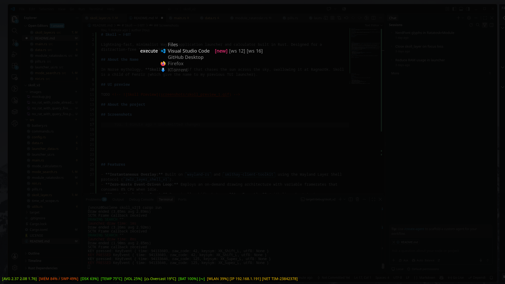
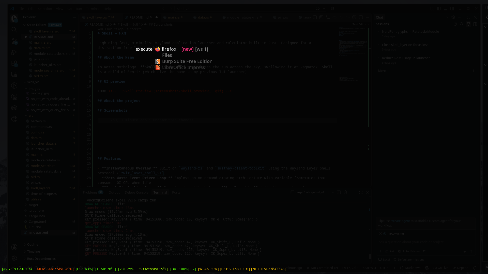
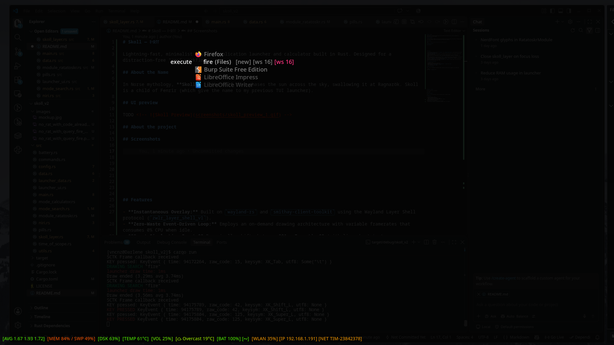
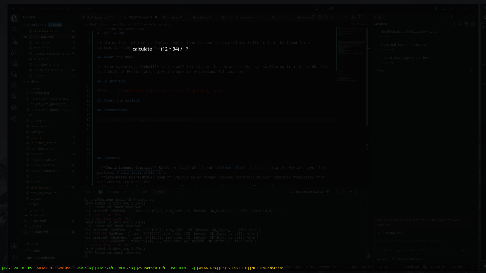
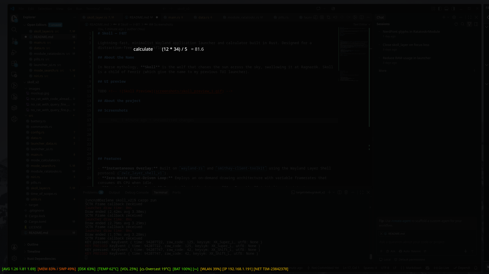

# Skoll — ᛊᚲᛟᛚᛚ

Lightning-fast, minimalist Wayland application launcher and calculator built in Rust. Designed for a distraction-free "zen" workflow.

## About the Name

In Norse mythology, **Skoll** is the wolf that chases the sun across the sky, swallowing it at Ragnarök. Skoll is a child of Fenrir (which give the name to my previous TUI launcher).

## UI preview

TODO <!--  -->

## About the project

Skoll is built around a single, distraction-free active line that dynamically switches between two core modes based on your input:
- **Application Launcher & Niri Opener:** Quickly searches and launches system applications. If a queried application already has active instances running in Niri, Skoll displays them alongside workspace indicators (e.g., `[ws 3]`), allowing you to instantly tab-cycle and focus an existing window or spawn a new one. The search is robust against typing errors.
- **Instant Calculator:** Automatically detects mathematical expressions as you type, computing and displaying results inline in real time.

There is one more feature, in the bottom line of the monitor:
- **Ratatoskr Metrics Display:** Features a clean system footer powered by Ratatoskr data, keeping vital resource usage and performance stats visible at a glance without cluttering your workflow.

That's all.

Resource data (such as CPU, RAM, and disk usage) is retrieved via a Unix socket from another of my projects, Ratatoskr, which is also available on [GitHub](https://github.com/vncnz/ratatoskr).

Ratatoskr **will be** optional: if you choose not to run it, Skoll will not display resource warnings (for example, high CPU/RAM usage).

Initially, I implemented the previous version of Skoll using the GTK toolkit, but it was consuming a lot of RAM and it was really slow to show up. So I made good use of what I learnt writing [Heimdallr](https://github.com/vncnz/heimdallr) (another project of mine) and [Fenrir](https://github.com/vncnz/fenrir) (my TUI launcher), and I rewrote skoll from stratch, communicating directly with Wayland and using cairo as graphical library. With this approach, memory usage dropped to approximately 35 MB on my laptop when layer is closed, 53 MB when layer is open.
The impact on average load is around... well, 0.01 tops with layer open and compulsive keyboard interaction, so really small. I measured the impact on average load as the ratio between the time spent with the Skoll process in "Running" or "disk-sleep" status and the total measurement time.

## Technical

### Tools / crates

Built on `wayland-rs` and `smithay-client-toolkit` using the Wayland Layer Shell protocol (`zwlr_layer_shell_v1`). Drawn with `cairo-rs`.

### Timings

On my personal laptop, application list loading takes about 60ms. It is done once as process starts and the result is cached, so it doesn't impact the launcher reactivity. Opening time of the layer is composed by three phases:

- Check which monitor has the focus (~20ms)
- Load Niri windows (~20ms)
- First draw after layer on-the-fly creation (~1ms)

So, on my laptop, I have something like **40ms of opening time** - two or three frames on a 60fps monitor. I'll work to reduce this time, but it depends on external interactions (outputs and Niri's IPC)

When I press a key, updating internal state and redraw the screen takes 1ms or less.

### Framerate

Skoll has a variable fps, because it redraws the layer only when it is triggered by two kind of events:
- user pressed a key, so internal state is changed
- two seconds are passed since last redraw, so information regarding computer health are obsolete

## Usage

There is no mouse interaction. When layer is open, Skoll react to the following keys:

- Letters and space: update the applications filter
- Numbers, round brackets, operation symbols, space: update the calculator input
- Tab: cycle over start/open options, if the candidate application counts active windows
- Enter: in launcher mode, launch or open an existing window of the candidate application, depending on your tab-selected option
- Esc: close the layer

If for some reason the layer loses the focus, it will be automatically closed.

## Running instructions

You must start skoll and let it run in background. When you want to use it you can write a command on the PIPE file /tmp/skoll_cmds. There are three commands managed: `"open"`, `"close"`, `"toggle"`. Names are self-explanatory.

For example, with Niri you can put in its configuration the following lines:

```kdl
spawn-sh-at-startup "skoll"

binds {
    Mod+D { spawn-sh "echo toggle > /tmp/skoll_cmds"; }
}
```

## Configuration

You can configure colors with a json file in ```~/.config/skoll/config.json```:

```js
{
    "background_color": [red,green,blue,alpha] | "random" | null,
    "accent_color": [red,green,blue,alpha] | "random" | null
}
```

For example:

```js
{
    "background_color": [0.1, 0.2, 0.2, 0.9],
    "accent_color": [0.6, 0.1, 0.0, 1.0]
}
```

- `background_color`: Accepts RGBA color values or `"random"`. When set to `"random"`, the color is automatically generated (Note: it is really random, at the moment, not a "nice random"). This is the color for the layer covering the entire screen when the launcher is visible.

- `accent_color`: Accepts RGBA color values or `"random"`. When set to `"random"`, the color is automatically generated (Note: it is really random, at the moment, not a "nice random"). This is the color of the selector of existing windows.

Default values are the following:

```js
{
    "background_color": [0.0, 0.0, 0.0, 0.85],
    "accent_color": [1.0, 0.2, 0.5, 1.0]
}
```


## Screenshots

Visual studio code as candidate app, two instances on different workspaces, selected new launch:


Querying "fire", selected new instance launch over existing windows:


Querying "fire", but selected an existing instance of `Files` application


Calculator mode, invalid expression


Calculator mode, valid expression


## TODOs

- ~~Cache app icons~~ Done!
- Make Ratatoskr integration optional
- Improve ratatoskr connection/disconnection management
- Make Niri integration optional
- ~~Make accent color configurable~~ Done!
- ~~Make background opacity / color configurable~~ Done!
- ~~Reset query on activation~~ Done!
- ~~Don't close layer on KEY_ENTER if no selection is active~~ Done!
- Add history to the calculator
- Add capability of variable usage to the calculator
- Cache app icons _before_ first opening (at daemon launch, for example)
- Add a config parameter for Ratatoskr information updates? For example, a fixed time (like now, but configurable) or the string "on-update" or "never"/"on-clock"
- Add a clock?
